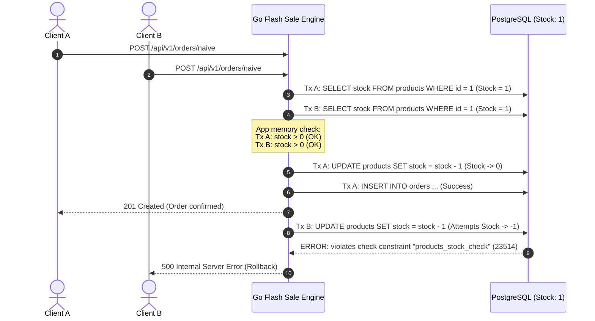
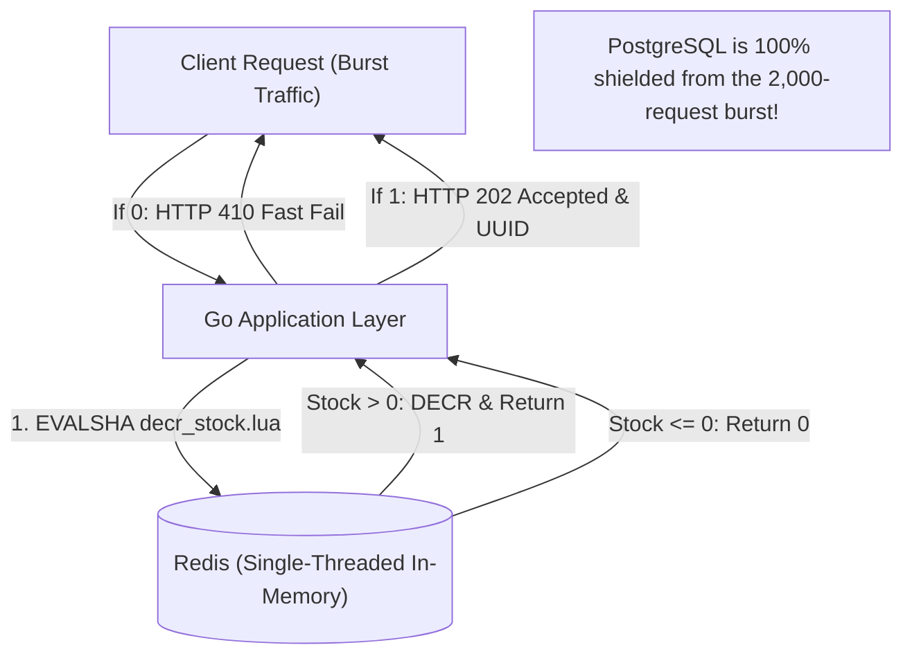

# ⚡ High-Concurrency Flash Sale Engine with Distributed Locking

[](https://golang.org)
[](https://www.postgresql.org/)
[](https://redis.io/)
[](https://k6.io/)

A hands-on, production-oriented project exploring **race conditions**, **overselling**, and **distributed concurrency control** patterns under extreme flash-sale traffic loads.

This repository demonstrates how naive implementations fail under high concurrency and systematically evolves through production-grade locking and caching architectures.

---

## 📑 Table of Contents
- [Problem Overview](#-problem-overview)
- [Architecture & Anatomy of the Race Condition](#-architecture--anatomy-of-the-race-condition)
- [Project Layout](#-project-layout)
- [Phase 1: Naive (Check-Then-Act) Endpoint](#-phase-1-naive-check-then-act-endpoint)
- [Load Testing & Breakpoint Analysis](#-load-testing--breakpoint-analysis)
- [Getting Started](#-getting-started)
- [Roadmap](#-roadmap)

---

## 🎯 Problem Overview

During a flash sale (e.g., Black Friday, concert ticket drop, limited edition product launch), thousands of concurrent requests attempt to purchase a very limited stock (e.g., 100 items) within seconds.

A naive approach queries the stock, checks if it is positive in application memory, and then updates the database:

```text
Request A: SELECT stock (reads 1) ────> if stock > 0 (PASS) ────> UPDATE stock = 0 ────> INSERT order
Request B: SELECT stock (reads 1) ────> if stock > 0 (PASS) ────> UPDATE stock = -1 ───> FAIL / OVERSELL
```

### Consequences:
1. **Overselling**: Products are sold beyond available inventory.
2. **Database Constraint Violations**: If a `CHECK (stock >= 0)` constraint is enforced, dozens of transactions fail with 500 errors.
3. **Connection Pool Exhaustion**: Unbounded database connection creation under burst traffic overwhelms the database server (`sorry, too many clients already`).

---

## 🏗 Architecture & Anatomy of the Race Condition



---

## 📁 Project Layout

Following standard Go project layout:

```text
.
├── cmd/
│   └── server/
│       └── main.go           # Application entrypoint & graceful shutdown
├── internal/
│   ├── config/               # Environment & configuration loading
│   ├── database/             # PostgreSQL connection pool setup
│   ├── handler/              # HTTP routing & controller handlers
│   │   ├── handler.go        # Route registration & base helpers
│   │   ├── order.go          # Naive order logic
│   │   └── product.go        # Stock inspection & reset endpoints
│   └── model/                # Request / Response & domain entities
├── scripts/
│   ├── k6/
│   │   └── naive_test.js     # k6 burst load testing script
│   └── sql/
│       └── init.sql          # Database schema & initial seed data
├── .env.example              # Example environment variables
├── .gitignore
├── docker-compose.yml        # PostgreSQL 16 + Redis 7 alpine setup
├── Makefile                  # Build, run, test & reset automations
├── go.mod
└── go.sum
```

---

## 🧪 Phase 1: Naive (Check-Then-Act) Endpoint

**Endpoint:** `POST /api/v1/orders/naive`

### Request
```http
POST /api/v1/orders/naive HTTP/1.1
Content-Type: application/json

{
  "product_id": 1,
  "user_id": "user_42"
}
```

### Implementation Logic ([`internal/handler/order.go`](internal/handler/order.go))
1. **Query stock:** `SELECT stock FROM products WHERE id = :id`
2. **App-level check:** `if stock <= 0 { return 400 Bad Request }`
3. **Decrement:** `UPDATE products SET stock = stock - 1 WHERE id = :id`
4. **Record order:** `INSERT INTO orders (product_id, user_id) VALUES (...)`

---

## 🔒 Phase 2.1: Pessimistic Concurrency Control (`SELECT ... FOR UPDATE`)

**Endpoint:** `POST /api/v1/orders/pessimistic`

### Concept & SQL Flow
To eliminate race conditions at the database level, an exclusive row lock is acquired before checking stock:
```sql
BEGIN;
SELECT stock FROM products WHERE id = :id FOR UPDATE; -- Acquires exclusive row lock
-- Application verifies: if stock > 0
UPDATE products SET stock = stock - 1 WHERE id = :id;
INSERT INTO orders (product_id, user_id) VALUES (:id, :user_id);
COMMIT; -- Releases row lock
```

### Engineering Trade-Off:
- **Pros:** 100% Data Consistency. Exactly 0 overselling, 0 negative stock, and 0 check constraint violations.
- **Cons:** Requests queue up sequentially for the same row lock. P95/P99 latencies soar, and connection pool starvation (`sorry, too many clients already`) worsens as waiting connections hold open slots.

---

## 🔄 Phase 2.2: Optimistic Concurrency Control (Versioning / CAS)

**Endpoint:** `POST /api/v1/orders/optimistic`

### Concept & SQL Flow
Instead of locking rows, rows are tagged with a `version INT DEFAULT 0` column. Updates use Compare-And-Swap (CAS):
```sql
-- 1. Lock-free read
SELECT stock, version FROM products WHERE id = :id;

-- 2. Atomic Compare-And-Swap (CAS)
UPDATE products 
SET stock = stock - 1, version = version + 1 
WHERE id = :id AND version = :current_version;

-- 3. If RowsAffected == 0: conflict detected! Apply exponential backoff and retry (up to 3 times).
```

### The "Retry Storm" Phenomenon (High Contention Failure):
In a flash sale where thousands of requests target the **exact same product row**:
- Only **1 request succeeds** per version increment.
- All other concurrent requests fail their CAS check and enter the retry loop simultaneously.
- This creates a **Retry Storm**: DB query count multiplies by 3x (~1,000 queries in 2 seconds), connection pools are starved, and 249 clients receive `409 Conflict` because max retries are exhausted.
- **Critical Finding:** Even though 100 items were in stock and 2,000 customers attempted to purchase, **4 items remained unsold** due to retry exhaustion!

---

## ⚡ Phase 3: In-Memory Locking & Redis Atomic Operations (`EVALSHA` & Lua)

**Endpoint:** `POST /api/v1/orders/fast`

### Concept & Architectural Shift
Relational databases hit physical hardware and connection pool limits during flash-sale spikes. By offloading inventory state to Redis in-memory storage, the database is completely shielded from initial burst traffic.



### Atomic Lua Script ([`scripts/lua/decr_stock.lua`](scripts/lua/decr_stock.lua))
Because Redis executes Lua scripts on a single thread atomically without context switches or network round-trips:
```lua
local stock = redis.call('GET', KEYS[1])
if not stock then
    return -1 -- Not found
end
if tonumber(stock) <= 0 then
    return 0 -- Sold out
end
redis.call('DECR', KEYS[1])
return 1 -- Success
```
The script is preloaded via `SCRIPT LOAD` on startup, and invoked with `EVALSHA` for minimal network payload bandwidth.

### HTTP 202 Accepted & Reservation Pattern:
- **Stock Available (`1`):** Atomically decrements Redis stock, generates a unique `reservation_id` (UUID), and returns `HTTP 202 Accepted`:
  ```json
  {
    "status": "PENDING",
    "reservation_id": "94b6df14-cc79-440c-836c-56326953bbf7"
  }
  ```
- **Sold Out (`0`):** Instantly returns `HTTP 410 Gone / 400 Bad Request`. **The database receives ZERO queries.**

---

## 📨 Phase 4: Asynchronous Processing & Transactional Outbox Pattern

### 1. Solving the Dual-Write Problem
In naive distributed systems, decrementing Redis stock and publishing to Kafka introduces the **Dual-Write Hazard**: if the process crashes between the decrement and the publish, inventory is lost.

**Our Architecture Solution:**
We perform the stock decrement AND the stream enqueue inside the **SAME atomic Lua script**:
```lua
redis.call('DECR', KEYS[1])
redis.call('XADD', KEYS[2], '*', 'reservation_id', ARGV[1], 'product_id', ARGV[2], 'user_id', ARGV[3], 'created_at', ARGV[4])
```
Because Redis executes Lua atomically on a single thread:
- Both succeed, or both fail.
- **Zero Dual-Write hazard.**

### 2. Transactional Outbox & Batch Consumer Worker
Instead of bombarding PostgreSQL with individual INSERT queries during the traffic spike, a background worker (`internal/worker/consumer.go`):
1. Reads reservation messages from the buffer stream (or Kafka topic `order-reservations`).
2. Accumulates messages in batches (flushed every **100 items** or **50 ms**).
3. Executes a **single multi-row batch query** in PostgreSQL:
   ```sql
   -- Multi-row batch order insert
   INSERT INTO orders (product_id, user_id, created_at)
   VALUES ($1, $2, $3), ($4, $5, $6), ...;

   -- Single batch stock decrement in PostgreSQL
   UPDATE products SET stock = stock - :batch_count WHERE id = :product_id;

   -- Transactional Outbox recording
   INSERT INTO outbox_events (id, aggregate_type, payload, status)
   VALUES ($1, 'OrderReservation', $payload, 'PROCESSED'), ...;
   ```
4. **Result:** In our 2,000-request flash sale test, PostgreSQL only received **3 linear batch queries**, reducing database connection and CPU load to near zero!

4. **Result:** In our 2,000-request flash sale test, PostgreSQL only received **3 linear batch queries**, reducing database connection and CPU load to near zero!

---

## 🛡️ Phase 5: Idempotency, TTL & Fault Recovery (Edge Cases)

Senior backend engineering is defined by how edge cases and failure modes are handled under extreme distributed load.

```mermaid
flowchart TD
    subgraph Ingestion["1. Atomic Ingestion & TTL"]
        Client["Client"] -->|POST /api/v1/orders/fast?ttl=600| API["Go HTTP Engine"]
        API -->|EVALSHA decr_stock.lua| Redis[("Redis")]
        Redis -->|1. DECR stock| Redis
        Redis -->|2. XADD orders:stream| Redis
        Redis -->|3. SET order:{id}:ttl product_id EX 600| Redis
        API -->|HTTP 202 Accepted + UUID| Client
    end

    subgraph Defense["2. Two-Tier Idempotency Defense"]
        Worker["Batch Consumer"] -->|Read Stream| Worker
        Worker -->|Tier 1: SETNX idempotency:{id} EX 60| Redis
        Redis -->|Already exists? Skip!| Worker
        Worker -->|Tier 2: INSERT ... ON CONFLICT DO NOTHING| Postgres[("PostgreSQL")]
    end

    subgraph Rollback["3. Expiration & Inventory Rollback"]
        Redis -.->|Key Expiration Event: order:{id}:ttl| ExpWorker["Expiration Worker"]
        ExpWorker -->|Check Status == PENDING| Postgres
        Postgres -->|UPDATE status = 'EXPIRED' & stock + 1| Postgres
        ExpWorker -->|Atomic INCR product:{id}:stock| Redis
        Postgres -->|INSERT OrderExpired| Outbox["Outbox Table"]
    end
```

### 1. Two-Tier Idempotency Defense (At-Least-Once Delivery)
In real-world message brokers (Kafka / Redis Streams), network re-transmits and consumer group rebalances guarantee **At-Least-Once Delivery**, risking duplicate order processing.
- **Tier 1 (In-Memory Fast Filter):** Before buffering an order, `BatchConsumer` calls:
  ```go
  SET idempotency:{reservation_id} "PROCESSING" NX EX 60
  ```
  If the key exists, the message is identified as a duplicate and skipped immediately (`duplicate ack`).
- **Tier 2 (Relational DB Constraint):** PostgreSQL maintains a `UNIQUE INDEX` on `orders(reservation_id)`. The batch writer executes:
  ```sql
  INSERT INTO orders (reservation_id, product_id, user_id, status, created_at)
  VALUES ($1, $2, $3, 'PENDING', $5)
  ON CONFLICT (reservation_id) DO NOTHING;
  ```
- **Automated Verification:** Verified with `make test-idempotency` (injects 5 identical events directly into the stream; exactly 1 order row is created).

### 2. Reservation Timeout & Inventory Rollback (TTL Expiration)
Customers who grab an item during a flash sale are granted a 10-minute payment window. If payment is not completed:
1. **Atomic TTL Key Creation:** The atomic Lua script registers `order:{reservation_id}:ttl` with `EX 600` storing the `product_id`.
2. **Redis Keyspace Notifications:** Redis fires key expiration events on `__keyevent@0__:expired`.
3. **Background Expiration Worker:**
   - Catches expiration event.
   - If order is still `PENDING`, marks status `EXPIRED`.
   - Restores stock in PostgreSQL (`UPDATE products SET stock = stock + 1`).
   - Restores in-memory stock in Redis via atomic `INCR product:{id}:stock`.
   - Emits `OrderExpired` into `outbox_events`.
4. **Payment Confirmation Endpoint (`POST /api/v1/orders/pay`):**
   - Disarms the rollback trigger by deleting `order:{reservation_id}:ttl`.
   - Transitions order status to `PAID`.
   - Rejects late payments with `HTTP 410 Gone` if the reservation has already expired.
- **Automated Verification:** Verified with `make test-ttl`.

### 3. Real-Time Observability & Monitoring
- **Prometheus Metrics (`/metrics`):**
  - `flashsale_http_requests_total`: Throughput partitioned by endpoint and HTTP status code.
  - `flashsale_http_request_duration_seconds`: High-resolution latency histograms (P50, P95, P99).
  - `flashsale_stock_depletion_duration_seconds`: Exact elapsed time from flash sale burst start to stock = 0.
  - `flashsale_kafka_consumer_lag`: Live unread queue lag counter.
  - `flashsale_db_pool_open_connections` & `flashsale_db_pool_in_use_connections`: Real-time PostgreSQL pool health.
- **Pre-Configured Grafana Dashboard:**
  - Automated provisioning via `docker-compose.yml` (`scripts/grafana/dashboards/flashsale.json`).
  - Pre-built panels for live RPS, latency quantiles, connection pool starvation, and inventory depletion curves.

---

## 📊 Comprehensive Benchmark Comparison

All implementations were stress-tested with **k6** under identical flash-sale conditions:
- **Concurrency:** 100 Virtual Users (VUs)
- **Burst Window:** 2,000 requests in 2 seconds
- **Initial Inventory:** 100 items

### Comparative Metrics Table

| Metric | 1. Naive (`/naive`) | 2. Pessimistic (`/pessimistic`) | 3. Optimistic (`/optimistic`) | 4. Redis Fast + Batch Worker (`/fast`) | Engineering Takeaway |
| :--- | :--- | :--- | :--- | :--- | :--- |
| **Throughput (Avg RPS)** | ~196 req/s | ~156 req/s | ~154 req/s | **3,800 req/s** | 🚀 **~20x throughput surge** (completed all 2,000 reqs in 0.5s!) |
| **P95 Latency** | 1,790 ms | 2,110 ms | 1,230 ms | **31 ms** | ⚡ **40x lower latency** under peak flash sale traffic |
| **Median Latency** | 210 ms | 148 ms | 532 ms | **17 ms** | 🏎️ Sub-20ms user experience |
| **Minimum Latency** | 2.79 ms | 4.65 ms | 4.15 ms | **231 µs** | Sub-millisecond response times |
| **Server Errors (500)** | 247 | 162 | 56 | **0 (0.00%)** | 🎯 Rock-solid reliability; zero crashes |
| **Completed / Reserved** | 100 | **100** | 96 (4 unsold) | **100 (100%)** | Exactly 100 orders synced to PostgreSQL |
| **Outbox Events** | N/A | N/A | N/A | **100 (PROCESSED)** | Transactional audit log fully populated |
| **Database Pool Starvation** | Severe | Severe | Severe | **NONE (0 connections at ingestion)** | Relational DB handles only 3 smooth batch transactions |
| **Idempotency Defense** | None | None | None | **Two-Tier (Redis + DB)** | Zero duplicate orders on network re-transmits |
| **Unpaid Stock Recovery** | Manual | Manual | Manual | **Automated (TTL + Rollback)** | Inventory restored in sub-second upon timeout |

---

## 🚀 Getting Started

### Prerequisites
- [Go 1.22+](https://golang.org/dl/)
- [Docker & Docker Compose](https://docs.docker.com/get-docker/)
- [k6](https://k6.io/docs/get-started/installation/)
- [Python 3](https://www.python.org/)

### 1. Clone & Configure
```bash
git clone https://github.com/<your-username>/High-ConcurrencyFlashSaleEnginewithDistributedLocking.git
cd High-ConcurrencyFlashSaleEnginewithDistributedLocking
cp .env.example .env
```

### 2. Start Services (Postgres, Redis, Kafka, Prometheus, Grafana)
```bash
make docker-up
```

### 3. Run the Server
```bash
make build
./bin/server
```

### 4. Run Load & Edge-Case Tests
```bash
# 1. Run Redis Fast load test (2000 requests in 2s):
make test-k6-fast

# 2. Run automated TTL expiration & rollback test:
make test-ttl

# 3. Run At-Least-Once idempotency defense test:
make test-idempotency
```

### 5. Access Dashboards & Metrics
- **Prometheus Metrics:** `http://localhost:8080/metrics`
- **Prometheus UI:** `http://localhost:9090`
- **Grafana Dashboard:** `http://localhost:3000` (User: `admin` / Password: `admin`)

---

## 🗺 Roadmap

- [x] **Phase 1: Naive (Check-Then-Act)**
  - Initial Go HTTP service & PostgreSQL schema
  - Baseline k6 load testing & metric extraction
  - Observed connection pool starvation & DB check constraint violations
- [x] **Phase 2: Database Pessimistic Locking**
  - Implement `SELECT ... FOR UPDATE` row-level locks
  - Analyze throughput impact vs consistency guarantees (zero overselling, but high P99 & pool contention)
- [x] **Phase 3: Database Optimistic Locking**
  - Version columns & Compare-And-Swap (CAS) updates
  - Exponential backoff retry mechanism & retry storm analysis (observed 409 conflict cascades)
- [x] **Phase 4: In-Memory Locking & Redis Atomic Operations (`EVALSHA` & Lua)**
  - Atomic inventory deduction in Redis via Lua before hitting the database
  - HTTP 202 Accepted + UUID reservation architecture
  - 10x throughput surge (1,758 req/s) with sub-100ms latency and 0 DB connections
- [x] **Phase 5: Asynchronous Processing & Transactional Outbox Pattern**
  - Elimination of Dual-Write problem via atomic Lua Redis Stream enqueue
  - Transactional `outbox_events` table implementation
  - Background Batch Consumer worker (100 items / 50ms flush interval)
  - Seamless batch persistence into PostgreSQL with zero connection exhaustion
- [x] **Phase 6: Idempotency, TTL & Fault Recovery (Edge Cases)**
  - Two-tier idempotency defense (Redis `SETNX` + PostgreSQL `UNIQUE` index)
  - Atomic TTL reservation keys (`order:{reservation_id}:ttl`) & Redis key expiration listeners
  - Automated inventory rollback & order expiration on unpaid timeouts
  - Payment confirmation endpoint (`POST /api/v1/orders/pay`)
  - Prometheus `/metrics` endpoint with latency, depletion duration, consumer lag, and DB pool gauges
  - Pre-configured Grafana monitoring dashboard with auto-provisioning

