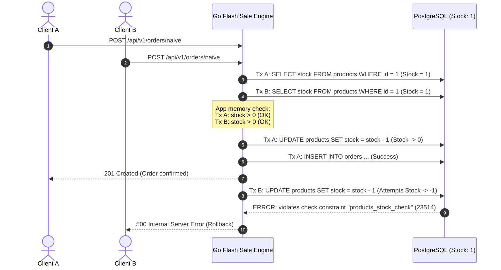
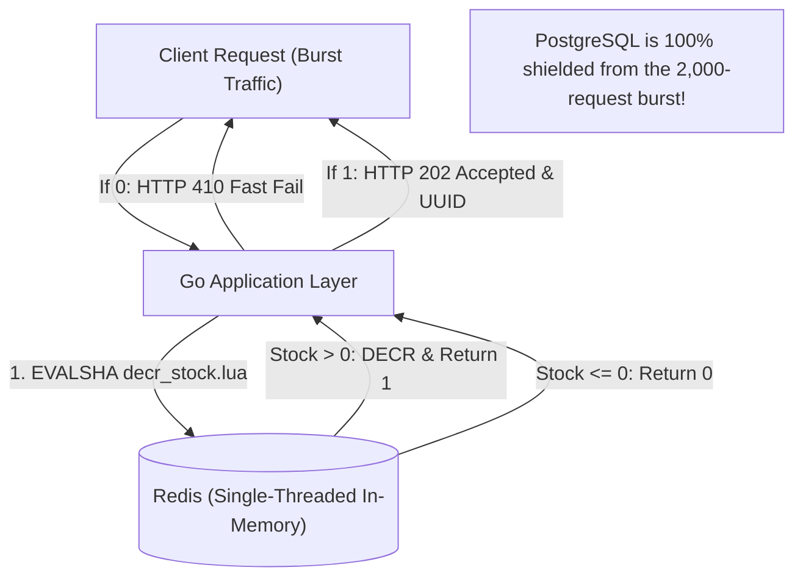

# ⚡ High-Concurrency Flash Sale Engine with Distributed Locking

[](https://golang.org)
[](https://www.postgresql.org/)
[](https://redis.io/)
[](https://k6.io/)

A hands-on, production-oriented project exploring **race conditions**, **overselling**, and **distributed concurrency control** patterns under extreme flash-sale traffic loads.

This repository demonstrates how naive implementations fail under high concurrency and systematically evolves through production-grade locking and caching architectures.

---

## 📑 Table of Contents
- [Problem Overview](#-problem-overview)
- [Architecture & Anatomy of the Race Condition](#-architecture--anatomy-of-the-race-condition)
- [Project Layout](#-project-layout)
- [Phase 1: Naive (Check-Then-Act) Endpoint](#-phase-1-naive-check-then-act-endpoint)
- [Load Testing & Breakpoint Analysis](#-load-testing--breakpoint-analysis)
- [Getting Started](#-getting-started)
- [Roadmap](#-roadmap)

---

## 🎯 Problem Overview

During a flash sale (e.g., Black Friday, concert ticket drop, limited edition product launch), thousands of concurrent requests attempt to purchase a very limited stock (e.g., 100 items) within seconds.

A naive approach queries the stock, checks if it is positive in application memory, and then updates the database:

```text
Request A: SELECT stock (reads 1) ────> if stock > 0 (PASS) ────> UPDATE stock = 0 ────> INSERT order
Request B: SELECT stock (reads 1) ────> if stock > 0 (PASS) ────> UPDATE stock = -1 ───> FAIL / OVERSELL
```

### Consequences:
1. **Overselling**: Products are sold beyond available inventory.
2. **Database Constraint Violations**: If a `CHECK (stock >= 0)` constraint is enforced, dozens of transactions fail with 500 errors.
3. **Connection Pool Exhaustion**: Unbounded database connection creation under burst traffic overwhelms the database server (`sorry, too many clients already`).

---

## 🏗 Architecture & Anatomy of the Race Condition



---

## 📁 Project Layout

Following standard Go project layout:

```text
.
├── cmd/
│   └── server/
│       └── main.go           # Application entrypoint & graceful shutdown
├── internal/
│   ├── config/               # Environment & configuration loading
│   ├── database/             # PostgreSQL connection pool setup
│   ├── handler/              # HTTP routing & controller handlers
│   │   ├── handler.go        # Route registration & base helpers
│   │   ├── order.go          # Naive order logic
│   │   └── product.go        # Stock inspection & reset endpoints
│   └── model/                # Request / Response & domain entities
├── scripts/
│   ├── k6/
│   │   └── naive_test.js     # k6 burst load testing script
│   └── sql/
│       └── init.sql          # Database schema & initial seed data
├── .env.example              # Example environment variables
├── .gitignore
├── docker-compose.yml        # PostgreSQL 16 + Redis 7 alpine setup
├── Makefile                  # Build, run, test & reset automations
├── go.mod
└── go.sum
```

---

## 🧪 Phase 1: Naive (Check-Then-Act) Endpoint

**Endpoint:** `POST /api/v1/orders/naive`

### Request
```http
POST /api/v1/orders/naive HTTP/1.1
Content-Type: application/json

{
  "product_id": 1,
  "user_id": "user_42"
}
```

### Implementation Logic ([`internal/handler/order.go`](internal/handler/order.go))
1. **Query stock:** `SELECT stock FROM products WHERE id = :id`
2. **App-level check:** `if stock <= 0 { return 400 Bad Request }`
3. **Decrement:** `UPDATE products SET stock = stock - 1 WHERE id = :id`
4. **Record order:** `INSERT INTO orders (product_id, user_id) VALUES (...)`

---

## 🔒 Phase 2.1: Pessimistic Concurrency Control (`SELECT ... FOR UPDATE`)

**Endpoint:** `POST /api/v1/orders/pessimistic`

### Concept & SQL Flow
To eliminate race conditions at the database level, an exclusive row lock is acquired before checking stock:
```sql
BEGIN;
SELECT stock FROM products WHERE id = :id FOR UPDATE; -- Acquires exclusive row lock
-- Application verifies: if stock > 0
UPDATE products SET stock = stock - 1 WHERE id = :id;
INSERT INTO orders (product_id, user_id) VALUES (:id, :user_id);
COMMIT; -- Releases row lock
```

### Engineering Trade-Off:
- **Pros:** 100% Data Consistency. Exactly 0 overselling, 0 negative stock, and 0 check constraint violations.
- **Cons:** Requests queue up sequentially for the same row lock. P95/P99 latencies soar, and connection pool starvation (`sorry, too many clients already`) worsens as waiting connections hold open slots.

---

## 🔄 Phase 2.2: Optimistic Concurrency Control (Versioning / CAS)

**Endpoint:** `POST /api/v1/orders/optimistic`

### Concept & SQL Flow
Instead of locking rows, rows are tagged with a `version INT DEFAULT 0` column. Updates use Compare-And-Swap (CAS):
```sql
-- 1. Lock-free read
SELECT stock, version FROM products WHERE id = :id;

-- 2. Atomic Compare-And-Swap (CAS)
UPDATE products 
SET stock = stock - 1, version = version + 1 
WHERE id = :id AND version = :current_version;

-- 3. If RowsAffected == 0: conflict detected! Apply exponential backoff and retry (up to 3 times).
```

### The "Retry Storm" Phenomenon (High Contention Failure):
In a flash sale where thousands of requests target the **exact same product row**:
- Only **1 request succeeds** per version increment.
- All other concurrent requests fail their CAS check and enter the retry loop simultaneously.
- This creates a **Retry Storm**: DB query count multiplies by 3x (~1,000 queries in 2 seconds), connection pools are starved, and 249 clients receive `409 Conflict` because max retries are exhausted.
- **Critical Finding:** Even though 100 items were in stock and 2,000 customers attempted to purchase, **4 items remained unsold** due to retry exhaustion!

---

## ⚡ Phase 3: In-Memory Locking & Redis Atomic Operations (`EVALSHA` & Lua)

**Endpoint:** `POST /api/v1/orders/fast`

### Concept & Architectural Shift
Relational databases hit physical hardware and connection pool limits during flash-sale spikes. By offloading inventory state to Redis in-memory storage, the database is completely shielded from initial burst traffic.



### Atomic Lua Script ([`scripts/lua/decr_stock.lua`](scripts/lua/decr_stock.lua))
Because Redis executes Lua scripts on a single thread atomically without context switches or network round-trips:
```lua
local stock = redis.call('GET', KEYS[1])
if not stock then
    return -1 -- Not found
end
if tonumber(stock) <= 0 then
    return 0 -- Sold out
end
redis.call('DECR', KEYS[1])
return 1 -- Success
```
The script is preloaded via `SCRIPT LOAD` on startup, and invoked with `EVALSHA` for minimal network payload bandwidth.

### HTTP 202 Accepted & Reservation Pattern:
- **Stock Available (`1`):** Atomically decrements Redis stock, generates a unique `reservation_id` (UUID), and returns `HTTP 202 Accepted`:
  ```json
  {
    "status": "PENDING",
    "reservation_id": "94b6df14-cc79-440c-836c-56326953bbf7"
  }
  ```
- **Sold Out (`0`):** Instantly returns `HTTP 410 Gone / 400 Bad Request`. **The database receives ZERO queries.**

---

## 📊 Comprehensive 4-Way Benchmark Comparison

All implementations were stress-tested with **k6** under identical flash-sale conditions:
- **Concurrency:** 100 Virtual Users (VUs)
- **Burst Window:** 2,000 requests in 2 seconds
- **Initial Inventory:** 100 items

### Comparative Metrics Table

| Metric | 1. Naive (`/naive`) | 2. Pessimistic (`/pessimistic`) | 3. Optimistic (`/optimistic`) | 4. Redis Fast (`/fast`) | Engineering Takeaway |
| :--- | :--- | :--- | :--- | :--- | :--- |
| **Throughput (Avg RPS)** | ~196 req/s | ~156 req/s | ~154 req/s | **1,758 req/s** | 🚀 **~10x throughput surge** (completed all 2,000 reqs in 1.1s!) |
| **P95 Latency** | 1,790 ms | 2,110 ms | 1,230 ms | **135 ms** | ⚡ **10x to 15x lower latency** under maximum load |
| **Median Latency** | 210 ms | 148 ms | 532 ms | **34 ms** | Sub-50ms user experience |
| **Check Constraint Errors** | **Yes** (`stock_check`) | **0** | **0** | **0** | 🛡️ Zero relational database errors |
| **Server Errors (500)** | 247 | 162 | 56 | **0 (0.00%)** | 🎯 Rock-solid reliability; zero crashes |
| **Completed / Reserved (201/202)** | 100 | **100** | 96 (4 unsold) | **100 (100%)** | Exactly 100 items reserved; zero overselling |
| **Fast-Failed Sold Out (410)** | 0 | 0 | 0 | **1,900** | 1,900 clients failed fast without touching the DB |
| **Database Pool Starvation** | Severe | Severe | Severe | **NONE (0 connections)** | Relational DB is completely immune to the traffic surge |

---

## 🚀 Getting Started

### Prerequisites
- [Go 1.22+](https://golang.org/dl/)
- [Docker & Docker Compose](https://docs.docker.com/get-docker/)
- [k6](https://k6.io/docs/get-started/installation/)

### 1. Clone & Configure
```bash
git clone https://github.com/<your-username>/High-ConcurrencyFlashSaleEnginewithDistributedLocking.git
cd High-ConcurrencyFlashSaleEnginewithDistributedLocking
cp .env.example .env
```

### 2. Start PostgreSQL & Redis
```bash
make docker-up
```

### 3. Run the Server
```bash
make run
# Or compile and run binary:
make build
./bin/server
```

### 4. Run the Naive Load Test
```bash
# In a separate terminal:
make test-k6-naive
```

### 5. Reset Stock & Orders for Next Run
```bash
make db-reset
```

---

## 🗺 Roadmap

- [x] **Phase 1: Naive (Check-Then-Act)**
  - Initial Go HTTP service & PostgreSQL schema
  - Baseline k6 load testing & metric extraction
  - Observed connection pool starvation & DB check constraint violations
- [x] **Phase 2: Database Pessimistic Locking**
  - Implement `SELECT ... FOR UPDATE` row-level locks
  - Analyze throughput impact vs consistency guarantees (zero overselling, but high P99 & pool contention)
- [x] **Phase 3: Database Optimistic Locking**
  - Version columns & Compare-And-Swap (CAS) updates
  - Exponential backoff retry mechanism & retry storm analysis (observed 409 conflict cascades)
- [x] **Phase 4: In-Memory Locking & Redis Atomic Operations (`EVALSHA` & Lua)**
  - Atomic inventory deduction in Redis via Lua before hitting the database
  - HTTP 202 Accepted + UUID reservation architecture
  - 10x throughput surge (1,758 req/s) with sub-100ms latency and 0 DB connections
- [ ] **Phase 5: Asynchronous Order Processing**
  - Decoupling checkout requests via Message Queue (Kafka / RabbitMQ)
  - Eventual consistency & order fulfillment workers
