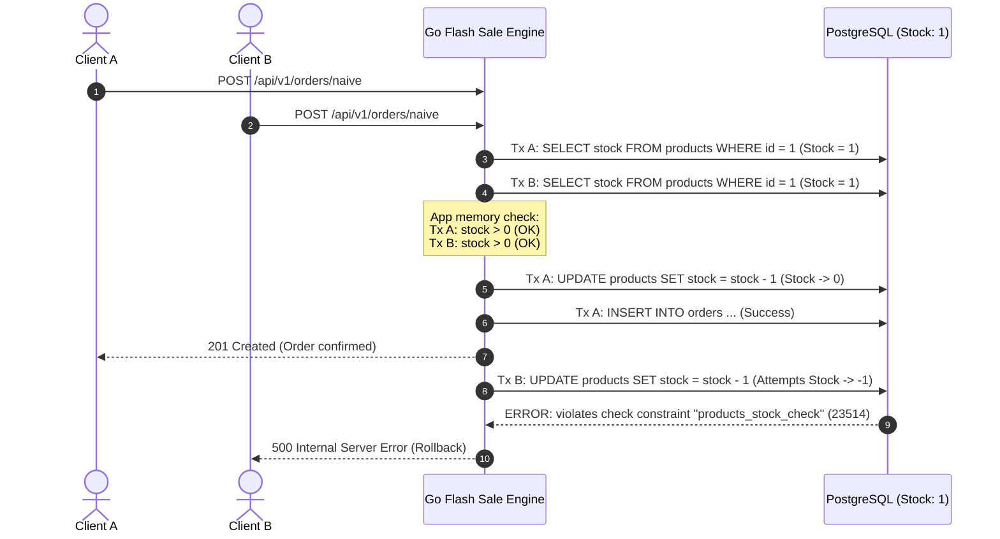

# ⚡ High-Concurrency Flash Sale Engine with Distributed Locking

[](https://golang.org)
[](https://www.postgresql.org/)
[](https://redis.io/)
[](https://k6.io/)

A hands-on, production-oriented project exploring **race conditions**, **overselling**, and **distributed concurrency control** patterns under extreme flash-sale traffic loads.

This repository demonstrates how naive implementations fail under high concurrency and systematically evolves through production-grade locking and caching architectures.

---

## 📑 Table of Contents
- [Problem Overview](#-problem-overview)
- [Architecture & Anatomy of the Race Condition](#-architecture--anatomy-of-the-race-condition)
- [Project Layout](#-project-layout)
- [Phase 1: Naive (Check-Then-Act) Endpoint](#-phase-1-naive-check-then-act-endpoint)
- [Load Testing & Breakpoint Analysis](#-load-testing--breakpoint-analysis)
- [Getting Started](#-getting-started)
- [Roadmap](#-roadmap)

---

## 🎯 Problem Overview

During a flash sale (e.g., Black Friday, concert ticket drop, limited edition product launch), thousands of concurrent requests attempt to purchase a very limited stock (e.g., 100 items) within seconds.

A naive approach queries the stock, checks if it is positive in application memory, and then updates the database:

```text
Request A: SELECT stock (reads 1) ────> if stock > 0 (PASS) ────> UPDATE stock = 0 ────> INSERT order
Request B: SELECT stock (reads 1) ────> if stock > 0 (PASS) ────> UPDATE stock = -1 ───> FAIL / OVERSELL
```

### Consequences:
1. **Overselling**: Products are sold beyond available inventory.
2. **Database Constraint Violations**: If a `CHECK (stock >= 0)` constraint is enforced, dozens of transactions fail with 500 errors.
3. **Connection Pool Exhaustion**: Unbounded database connection creation under burst traffic overwhelms the database server (`sorry, too many clients already`).

---

## 🏗 Architecture & Anatomy of the Race Condition



---

## 📁 Project Layout

Following standard Go project layout:

```text
.
├── cmd/
│   └── server/
│       └── main.go           # Application entrypoint & graceful shutdown
├── internal/
│   ├── config/               # Environment & configuration loading
│   ├── database/             # PostgreSQL connection pool setup
│   ├── handler/              # HTTP routing & controller handlers
│   │   ├── handler.go        # Route registration & base helpers
│   │   ├── order.go          # Naive order logic
│   │   └── product.go        # Stock inspection & reset endpoints
│   └── model/                # Request / Response & domain entities
├── scripts/
│   ├── k6/
│   │   └── naive_test.js     # k6 burst load testing script
│   └── sql/
│       └── init.sql          # Database schema & initial seed data
├── .env.example              # Example environment variables
├── .gitignore
├── docker-compose.yml        # PostgreSQL 16 + Redis 7 alpine setup
├── Makefile                  # Build, run, test & reset automations
├── go.mod
└── go.sum
```

---

## 🧪 Phase 1: Naive (Check-Then-Act) Endpoint

**Endpoint:** `POST /api/v1/orders/naive`

### Request
```http
POST /api/v1/orders/naive HTTP/1.1
Content-Type: application/json

{
  "product_id": 1,
  "user_id": "user_42"
}
```

### Implementation Logic ([`internal/handler/order.go`](internal/handler/order.go))
1. **Query stock:** `SELECT stock FROM products WHERE id = :id`
2. **App-level check:** `if stock <= 0 { return 400 Bad Request }`
3. **Decrement:** `UPDATE products SET stock = stock - 1 WHERE id = :id`
4. **Record order:** `INSERT INTO orders (product_id, user_id) VALUES (...)`

---

## 📊 Load Testing & Breakpoint Analysis

Load test executed with **k6** simulating a flash-sale spike:
- **Concurrency:** 100 Virtual Users (VUs)
- **Target:** 2,000 requests within a 2-second burst window
- **Initial Stock:** 100 items

### Benchmark Results

| Metric | Result | Description |
| :--- | :--- | :--- |
| **Throughput (Avg RPS)** | **~196 req/s** | Target 2,000 reqs throttled by lock contention and pool limits |
| **P95 Latency** | **1.79 s** | High latency due to connection queueing and row-level serialization |
| **P99 Latency** | **2.01 s** | Requests reaching duration timeouts |
| **Failure Rate (% Fail)** | **76.90%** | 333 out of 433 completed requests failed |
| **Completed Orders (201)** | **100** | Inventory limit reached |
| **Server / DB Crashes (500)** | **247** | Unhandled check constraints & pool starvation |

### Console Log Evidence

```log
# 1. Connection Pool Exhaustion:
[DB ERROR - BeginTx]: pq: sorry, too many clients already (53300)
[DB ERROR - BeginTx]: pq: remaining connection slots are reserved for roles with the SUPERUSER attribute (53300)

# 2. Race Condition - Check Constraint Violation:
[DB ERROR - Update Stock]: pq: new row for relation "products" violates check constraint "products_stock_check" (23514)
```

---

## 🚀 Getting Started

### Prerequisites
- [Go 1.22+](https://golang.org/dl/)
- [Docker & Docker Compose](https://docs.docker.com/get-docker/)
- [k6](https://k6.io/docs/get-started/installation/)

### 1. Clone & Configure
```bash
git clone https://github.com/<your-username>/High-ConcurrencyFlashSaleEnginewithDistributedLocking.git
cd High-ConcurrencyFlashSaleEnginewithDistributedLocking
cp .env.example .env
```

### 2. Start PostgreSQL & Redis
```bash
make docker-up
```

### 3. Run the Server
```bash
make run
# Or compile and run binary:
make build
./bin/server
```

### 4. Run the Naive Load Test
```bash
# In a separate terminal:
make test-k6-naive
```

### 5. Reset Stock & Orders for Next Run
```bash
make db-reset
```

---

## 🗺 Roadmap

- [x] **Phase 1: Naive (Check-Then-Act)**
  - Initial Go HTTP service & PostgreSQL schema
  - Baseline k6 load testing & metric extraction
  - Observed connection pool starvation & DB check constraint violations
- [ ] **Phase 2: Database Pessimistic Locking**
  - Implement `SELECT ... FOR UPDATE` row-level locks
  - Analyze throughput impact vs consistency guarantees
- [ ] **Phase 3: Database Optimistic Locking**
  - Version columns & Compare-And-Swap (CAS) updates
  - Retry mechanisms & backoff strategies
- [ ] **Phase 4: Distributed Locking with Redis (Redlock / Lua)**
  - Atomic inventory deduction in Redis before hitting the database
  - Distributed lock orchestration
- [ ] **Phase 5: Asynchronous Order Processing**
  - Decoupling checkout requests via Message Queue (Kafka / RabbitMQ)
  - Eventual consistency & order fulfillment workers
